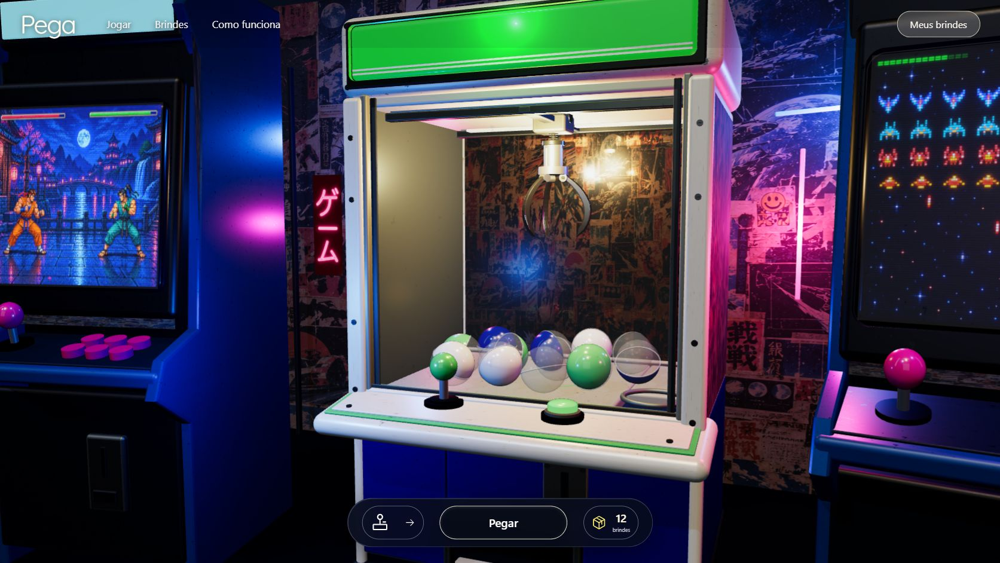

# Pega! — arcade de brindes em 3D

Máquina de garra interativa para sorteios locais, com gabinete tridimensional, cápsulas com física, joystick em dois eixos e ambiente de arcade retrô.



## Usar a versão pronta

Com Node.js instalado, dê dois cliques em **iniciar.cmd**. O servidor abre **http://127.0.0.1:4173/**. O build está incluído em `dist/`; não é necessário instalar pacotes nem conectar à internet para jogar.

Mantenha o mesmo endereço, navegador e perfil para acessar o cadastro salvo. Se a porta 4173 estiver ocupada, encerre o outro programa antes de iniciar. Não abra `dist/index.html` diretamente.

## Como jogar

- Mova a garra com o joystick, setas ou W/A/S/D e pressione **Pegar** ou Enter.
- O prêmio é aleatório e proporcional ao estoque; a mira escolhe apenas a cápsula física.
- Toda rodada com estoque captura uma cápsula. Resultado e baixa são registrados juntos antes da animação.
- Em **Meus brindes**, cadastre fotos locais, edite, reponha e exclua brindes.

Cadastro, fotos e estoque ficam no IndexedDB do navegador e **não são copiados para este repositório ou para o ZIP**. Limpar os dados do navegador remove o cadastro. Não há login, créditos pagos ou sincronização entre aparelhos.

## Desenvolvimento

React, TypeScript, Vite, Three.js, React Three Fiber e Drei, com versões fixadas no `package-lock.json`.

```sh
npm ci
npm run dev
npm test
npm run build
```

Node.js 24 é recomendado para desenvolver. A prévia usa a porta 4174, com armazenamento separado da versão distribuída em 4173. Testes de sorteio devem usar um cadastro isolado.

## Estrutura

- `src/`: interface React, cena 3D, física, controle da rodada e armazenamento.
- `public/`: texturas, fontes e ícones locais.
- `dist/`: build offline pronto, versionado para permitir uso sem instalação de pacotes.
- `tests/`: validações de sorteio, estoque, persistência, física e controles.
- `previas/`: referência visual e capturas da implementação.
- `server.cjs` e `iniciar.cmd`: servidor local e iniciador Windows.
- `LEIA-ME.md`: instruções completas de uso e edição.
- `ASSETS.md` e `licenses/`: origem e licenças dos recursos.
- `design-qa.md`: comparação visual e limitações conhecidas.

A reconstrução usa geometria 3D interativa e recursos locais. Há diferenças de materiais, reflexos e densidade de cápsulas em relação à referência fotográfica; consulte `design-qa.md`.
